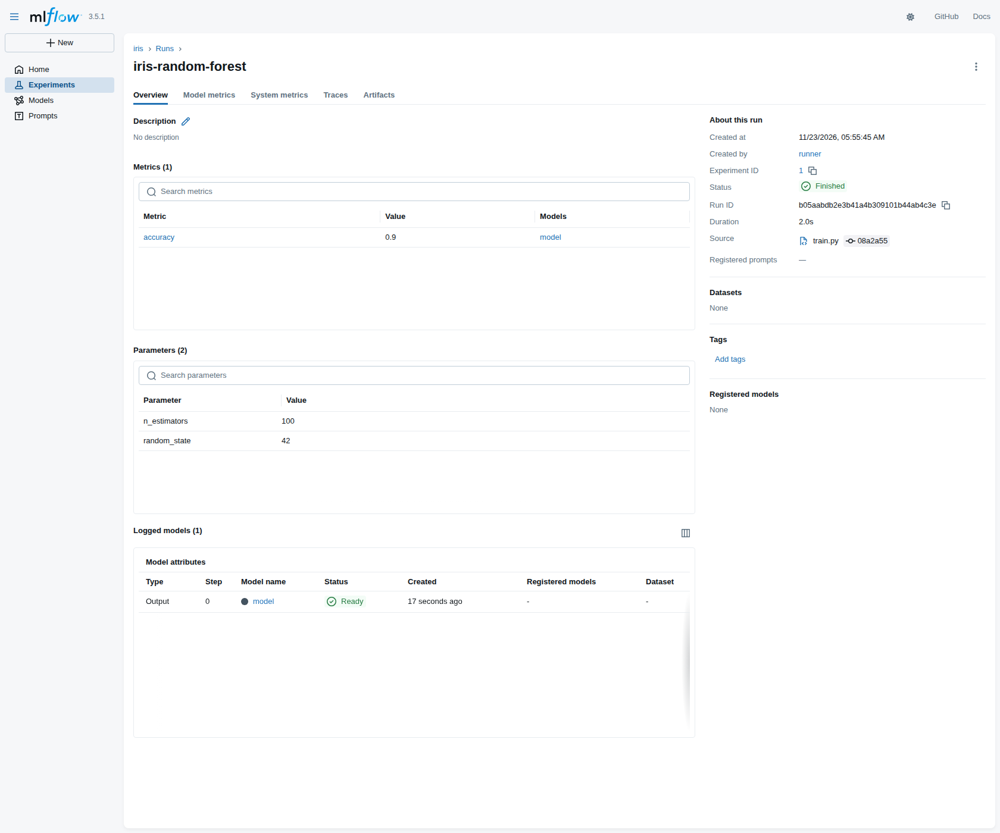
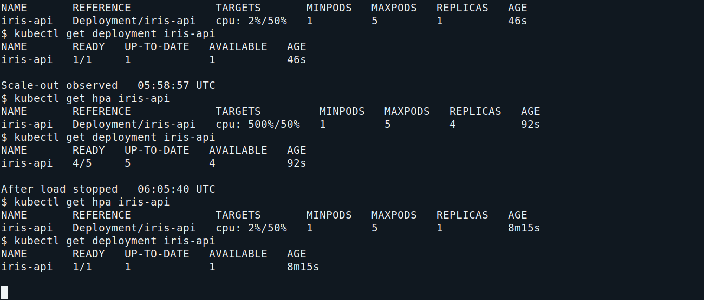

# Lab 1 · 在 Kubernetes 上部署 Iris 預測服務

本作業依《MLOps Foundations & Cloud Native AI》第 49–52 頁實作。用 scikit-learn 訓練模型，將同一次訓練產生的模型交給 FastAPI，在 Kubernetes 上以 CPU 使用率自動調整推論服務的副本數。

## 執行結果

2026-11-23 以 GitHub Actions 在臨時 kind 叢集完成端到端實驗。[查看本次成功執行與完整紀錄](https://github.com/charlie-lo/mlops-lab1-iris/actions/runs/45120673558)。

### MLflow Run

Random Forest 使用 100 棵樹，測試集預測正確 27/30 筆（accuracy 0.90）。Run ID 為 `b05aabdb2e3b41a4b309101b44ab4c3e`。



### HPA Scaling

`/predict` 對講義範例回傳 `{"predictions":[0]}`。下表取自同一次壓測的三個觀測時間點。

| 觀測時間（UTC） | 階段 | CPU 使用率 / 目標 | 副本數 |
| --- | --- | --- | --- |
| 05:58:11 | 壓測前 | 2% / 50% | 1 |
| 05:58:57 | 壓測中，觀察到擴容 | 500% / 50% | 4 |
| 06:05:40 | 壓測停止後，縮容完成 | 2% / 50% | 1 |



## 訓練與實驗追蹤

需要 Python 3.12。以下指令從 repository 根目錄執行。

```bash
python3.12 -m venv .venv
source .venv/bin/activate
python -m pip install -r requirements.txt
python train.py
mlflow server --backend-store-uri sqlite:///mlflow.db --port 5001
```

開啟 <http://localhost:5001>，在 `iris` 實驗中選擇 `iris-random-forest`。程式以分層取樣將 150 筆資料切成 120 筆訓練、30 筆測試，固定亂數種子為 42。每個 run 都會記錄 `n_estimators`、`random_state`、測試集 `accuracy` 及模型，並在專案目錄產生供映像建置使用的 `model.pkl`。

## 建置和部署

準備 Docker、kind 和 kubectl，啟動 Docker 後另開終端機。此處的 `mlops` 是專用本機實驗叢集。

```bash
kind create cluster --name mlops
docker build -t iris-api:v1 .
kind load docker-image iris-api:v1 --name mlops
kubectl --context kind-mlops apply -f k8s/
kubectl --context kind-mlops rollout status deployment/iris-api
kubectl --context kind-mlops port-forward svc/iris-api 8080:80
```

`k8s/deployment.yaml` 的 readiness probe 會檢查 `/healthz`。`k8s/service.yaml` 將 Service 的 port 80 導向容器的 port 8080。保持 port-forward 執行，在另一個終端機驗證健康檢查與推論。

```bash
curl -fsS http://127.0.0.1:8080/healthz
curl -fsS http://127.0.0.1:8080/predict \
  -H 'Content-Type: application/json' \
  -d '{"instances":[[5.1,3.5,1.4,0.2]]}'
```

四個數值依序為花萼長、花萼寬、花瓣長、花瓣寬，單位為公分。此筆範例預期得到 `{"predictions":[0]}`，類別 0 對應 setosa。

## 觀察 HPA 擴縮

`k8s/hpa.yaml` 將副本數設為 1–5，CPU 目標是各 Pod CPU request 的 50%。每個 Pod 的 request 為 100m，因此目標平均用量是 50m。若是全新的 kind 叢集，先安裝 metrics-server。下列 TLS 參數供本機 kind 的自簽 kubelet 憑證使用。

```bash
kubectl --context kind-mlops apply -f https://github.com/kubernetes-sigs/metrics-server/releases/download/v0.8.0/components.yaml
kubectl --context kind-mlops -n kube-system patch deploy metrics-server --type=json \
  -p='[{"op":"add","path":"/spec/template/spec/containers/0/args/-","value":"--kubelet-insecure-tls"}]'
kubectl --context kind-mlops -n kube-system rollout status deployment/metrics-server
kubectl --context kind-mlops top pods
kubectl --context kind-mlops get hpa iris-api -w
```

等到 HPA 的 TARGETS 顯示數字後，保持監看，另開終端機執行講義的 hey 壓測。這個範例透過 port-forward 對單一 Pod 送流量。GitHub Actions 則從叢集內對 Service 加壓，讓新增的副本也能處理請求。

```bash
hey -z 60s -c 50 -m POST -T application/json \
  -d '{"instances":[[5.1,3.5,1.4,0.2]]}' \
  http://127.0.0.1:8080/predict
```

觀察 `REPLICAS` 是否從 1 增加。壓測結束後繼續監看，預設縮容穩定期約 5 分鐘。實際達到的副本數取決於當次負載。
